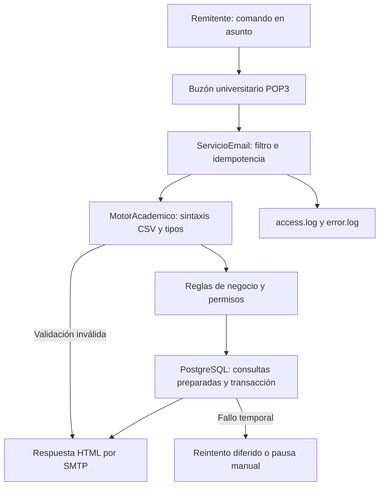

# Gestión Administrativa de Academia — Correo 22SC

Backend Java de los ocho casos académicos, con Checkout como función adicional.
El usuario envía un comando completo en el asunto; el cuerpo y los adjuntos no
se interpretan como instrucciones. Ejemplos: `usuario mostrar`, `ayuda`,
`curso agregar [Inglés;Curso inicial;100;1]`.

## Arquitectura



Código: `correo` contiene recepción, respuesta, registros y reintentos;
`dominio` valida comandos y aplica los casos; `datos` encapsula SQL y migración;
`pagos` genera el formulario de Checkout. No genera factura fiscal ni verifica
un pago bancario automáticamente.

## Base y configuración

PostgreSQL remoto: `tecnoweb.org.bo:5432`, base `db_grupo22sc`, usuario
`grupo22sc`. Java no necesita PostgreSQL ni Docker local.
Copiar `.env.remoto.example` a `.env.remoto` y completar sus valores privados.
No publicar este archivo, logs, respuestas HTML ni respaldos completos.

Modelo nuevo: 24 tablas, 29 relaciones. `pagos` referencia usuario, estudiante
y matrícula o trámite; `solicitudes_correo` referencia al remitente. Los registros
históricos incompletos se conservan con indicadores pendientes. `migraciones`
es técnica y no requiere relaciones artificiales. Ver `docs/relaciones-correo.md`.

**Migración aplicada en db_grupo22sc el 19/11/2026, con respaldo previo.**
El esquema nuevo de documentación está en `docs/correo_academia_modelo_actualizado.sql`.
Para actualizar una base existente, respaldarla y aplicar
`docs/aplicar-relaciones-correo.sql`. Nunca ejecutar el esquema de creación
sobre una base ya instalada. El arranque Java también aplica las migraciones.
No ejecutar una versión anterior junto con esta sobre el buzón.

## Requisitos y arranque manual

JDK 17 o superior y Maven (versión de referencia 3.9.9). Mantener una sola
instancia del receptor. El proyecto no instala servicios ni arranque automático.
No se instalaron paquetes como parte de estos cambios.

Linux, desde esta carpeta (Bash; desde fish ejecutar primero `bash`):

```bash
bash mvn-local.sh compile dependency:copy-dependencies -DincludeScope=runtime
set -a
source .env.remoto
set +a
java -cp 'target/classes:target/dependency/*' org.academia.correo.ServicioEmail --listen
```

Windows PowerShell, desde esta carpeta:

```powershell
mvn compile dependency:copy-dependencies -DincludeScope=runtime
Get-Content .env.remoto -Encoding UTF8 | ForEach-Object {
    if ($_ -match '^\s*([A-Za-z_][A-Za-z0-9_]*)=(.*)$') {
        [Environment]::SetEnvironmentVariable($Matches[1], $Matches[2].Trim().Trim([char]34).Trim([char]39), 'Process')
    }
}
java -cp "target/classes;target/dependency/*" org.academia.correo.ServicioEmail --listen
```

Alternativas: `bash ejecutar-local.sh --listen` o
`powershell -File .\ejecutar-windows.ps1 --listen`.
Ctrl+C detiene el proceso. Cerrar la terminal también lo detiene.
`--init` inicializa/migra la base, `--once` revisa el buzón una vez y
`--execute ASUNTO REMITENTE ID` ejecuta un comando contra la base sin SMTP.
Estos modos tienen efectos reales: no son comprobaciones sin cambios.

## Parser

Acepta palabras separadas, mayúsculas/minúsculas, espacios extra y acentos en
comandos. CSV admite coma o punto y coma; dentro de comillas un separador es
texto. Escapar una comilla doble duplicándola: `"Curso ""Inicial"""`.
Valida un único bloque de corchetes, comillas cerradas, cantidad de parámetros,
tipos, referencias y permisos. Los corchetes internos deben ir entre comillas.
Nombres y contraseñas no se convierten a mayúsculas. `help` y `ayuda` muestran
los comandos disponibles. Los pagos utilizan el mismo parser CSV.

Pago vinculado: `pago generar [70000000;ACA-001;0.01;Inscripción;matricula;1]`.
Los IDs deben existir; consultar los listados antes. Ver `docs/pago-facil-checkout.md`.

## Errores, logs y reintentos

Errores de validación, restricciones y formatos producen respuesta HTML con
error; la operación se revierte. Los errores de estructura SQL indican que hay
que aplicar migraciones. Los fallos de conexión/SMTP conservan el correo para
reintento. El backend conserva la respuesta exitosa para evitar repetir cambios
si falla SMTP; la entrega final puede requerir revisar Spam.

`logs/access.log` registra ciclo, identificador hash, nombre de comando y estado.
`logs/error.log` registra clase, SQLState y marcos de código de las causas;
no guarda parámetros del asunto, cuerpo, tokens ni mensajes SQL con valores.
Cada archivo rota a `.1` al superar 5 MB. Variables: `MAIL_LOG_DIR`,
`MAIL_RETRY_FILE` y `MAIL_MAX_RETRIES` (por defecto 5).

Los intentos se guardan en `.correo-reintentos.properties`. Se espera 30, 60,
120 segundos, etc., hasta un máximo de una hora. Al llegar al límite se pausa
el mensaje sin borrarlo ni marcarlo atendido. Errores de configuración por
mensaje se pausan directamente; fallos generales del buzón se registran y se
revisan en el siguiente ciclo. Después de corregir la causa, detener el receptor,
respaldar el archivo de reintentos y eliminar la entrada hash correspondiente
para reanudar esa solicitud. No borrar el registro de correos procesados.

Linux: `tail -f logs/access.log logs/error.log`.
PowerShell: `Get-Content logs/access.log -Tail 30 -Wait`.

## Entrega

`python3 preparar-entrega.py` genera `entrega/2026-2_INF513-P1_grupo22sc.zip`
con código, SQL, manuales y configuración de ejemplo, sin secretos ni históricos.
No confundir con el ZIP completo privado del respaldo previo.
Repositorio personal de entrega: https://github.com/jhasmany-fernandez/inf513-proyecto1
El remoto histórico organizacional se conserva en el checkout original; la
publicación personal utiliza una copia limpia sin historial antiguo ni secretos.
El despliegue del daemon en la universidad queda pendiente de acceso al servidor.
La preparación y las alternativas manual, systemd y cron están en
[despliegue del servidor](docs/despliegue-servidor.md). No se instalan ni activan
automáticamente; elegir una sola después de confirmar permisos y migración.

No se realizaron pruebas funcionales ni envíos de correo durante esta etapa.
